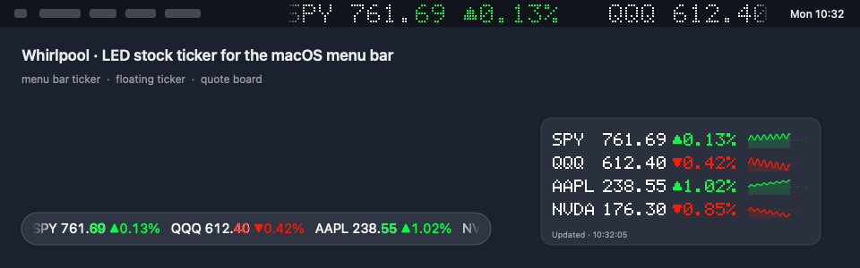

# WP行情帶 · Whirlpool

[简体中文](README.zh-CN.md) · 繁體中文 · [English](README.md)

<p align="center">
  
</p>

一個輕量的桌面自選行情工具：LED 跑馬燈、浮動行情條、緊湊報價卡，以及貼在螢幕邊緣的行情元件。

## 平台

| | macOS | Windows（預覽版） |
|---|---|---|
| 系統入口 | 選單列、浮動行情條、報價卡 | 工作列通知區域圖示、浮動行情條、報價卡 |
| 語言 | 中文 / 英文 / 跟隨系統 | 同左 |
| 行情 | 美股：東方財富優先，再騰訊、Yahoo 備援（設定裡可改）；A 股、港股：騰訊；指數、期貨、加密資產：Yahoo；或明確標註的模擬行情 | Yahoo / 騰訊，或模擬行情 |
| 顯示 | LED 點陣或系統字型跑馬燈，三檔字級；像素或系統字型報價卡；走勢圖 | LED 跑馬燈；原生報價卡 |
| 佈局 | 獨立顯示卡片、桌面預覽、邊緣錨點或自由位置；選單列寬度獨立 | 行情條/報價卡卡片、桌面預覽、邊緣錨點或自由位置 |
| 亮 / 暗 | 按顯示面各自適應（選單列、浮動條、報價卡） | 跟隨 Windows 應用模式，或固定淺色/深色 |
| 多自選池、小數位、節假日、更新提示 | 支援 | 支援 |
| 系統需求 | macOS 13 及以上 | Windows 10/11 x64（自包含，無需安裝 .NET） |


## 使用

macOS：開啟 `Whirlpool.app`，右鍵選單列、行情條或報價卡 → **設定…**。左鍵選單列圖示可暫停/收起與繼續；關閉選單列行情顯示後仍保留一個小選單列入口。

Whirlpool 2.0 的 macOS 設定使用 **自選股 / 佈局 / 外觀 / 通用** 四頁側邊欄，以圖形卡片選擇顯示區域、位置、字型與配色。Windows 使用 **佈局 / 外觀 / 自選股 / 通用** 四個分頁。

Windows：直接執行 `Whirlpool.exe`（免安裝）。右鍵工作列通知區域圖示、行情條或報價卡彈出選單，按兩下圖示開啟設定；Ctrl + 按一下行情條切換自選池，按兩下報價卡某行開啟圖表。設定在 `%APPDATA%\Whirlpool\config.json`（Pinwheel 時期的設定會自動複製過來一次）。Windows 仍為預覽版，實機驗收項目見 [Windows 驗收清單](docs/WINDOWS-TESTING.md)。

### 位置與寬度

- 在 **佈局** 頁分別開關顯示卡片。macOS 可組合選單列行情、浮動行情條與報價卡；Windows 可組合浮動行情條與報價卡，至少保留一個顯示區域。
- 選擇顯示器，再選浮動行情條的六個錨點：頂部或底部，靠左、置中或靠右。位置按可用桌面區域計算，避開 Dock、選單列或 Windows 工作列，並保留少量邊距。直接拖曳真實行情條會切到 **自由位置**；重新選擇錨點即可貼回相應邊緣。
- 浮動視窗寬度按 **20–100% 可用螢幕寬度** 調整，提供 **¼ / ½ / ⅔ / 鋪滿** 預設，也可拖曳真實行情條兩端縮放。置中與自由位置保持中心向兩邊伸縮；靠左或靠右時保持對應邊緣。鋪滿仍保留邊距，字級不再承擔調整視窗寬度的作用。
- macOS 的 **選單列寬度** 獨立設定，以 pt 為單位。macOS 在各螢幕選單列鏡射同一狀態項，共用一個寬度；Whirlpool 按所選螢幕（自動時為主螢幕）寬度的 60% 為上限。選單列擁擠時系統仍可能隱藏它，此時調小這項即可。

桌面預覽只修改設定草稿：可以拖曳預覽中的行情條和兩端，**儲存**後套用，**取消**不改動正在執行的佈局或已儲存設定。直接拖曳、縮放真實浮動視窗則立即生效並記住位置。升級保留舊自選股及相容的浮動視窗位置、寬度；主動調整寬度控制項後，相應顯示面才改用新的獨立寬度設定。

**鎖定浮動視窗位置** 防止誤拖和縮放；**浮動行情條點擊穿透** 讓滑鼠點到下面的視窗，需要操作行情條時可從選單列或系統匣圖示關閉。所選顯示器也決定報價卡的預設位置；佈局頁可以重設兩個浮動視窗的位置。

### 外觀與自選股

macOS 配色跟隨所在顯示面的明暗：暗色選單列上代號/價格為白色，亮色選單列上為近黑色；紅綠漲跌色在亮底自動換成對比度達標的深色版（**外觀 → 配色**：自適應、單色、琥珀、綠色）。浮動行情條可選毛玻璃膠囊背板；Windows 在 **外觀** 頁提供跟隨系統、淺色、深色主題卡片。滑鼠懸停在行情條上會暫停滾動；按兩下報價卡某一行（或選單 **打開圖表**）打開 TradingView / Yahoo 圖表。

macOS 滾動由 GPU 合成：每輪行情只繪製一次，Core Animation 按螢幕更新率推進，滾動時 app 自身 CPU 接近 0%。

可建多套自選池，在選單 **自選池**、macOS ⌥ 按一下行情條、Windows Ctrl + 按一下行情條或 macOS `whirlpool --list 名稱` 快速切換。價格小數位按品種自動決定（外匯 4 位、A 股 ETF 3 位、低價加密資產更多），也可在自選頁逐個指定。

代碼範例：`AAPL`、`^GSPC`、`600519`、`00700`、`BTC-USD`。同一代碼不能重複。A 股使用六位代碼，可加 `SH`/`SZ`/`BJ` 前綴指明交易所：`000001` 是深市平安銀行，`SH000001` 是上證指數；不加前綴時 6、5、9 開頭按滬市，4、8、92 開頭按北交所，其餘按深市。港股一至五位代碼會在請求時向左補零。在 **通用** 頁選擇行情來源。演示源使用模擬價格，狀態選單會明確標註。

## 更新與限流

預設建議 **30 秒**。所有顯示共用快取和一次進行中的行情請求。設定值表示兩次完整拉取之間的最短間隔，不代表交易所逐筆行情。滾動獨立執行，跑馬燈在下一輪採用新資料；手動更新也不能繞過限流等待或五秒的最短請求間隔。

開啟 **自選市場全部休市時放慢更新**（預設開啟）後，所有自選市場都休市時會放慢拉取，到下一次開盤自動恢復。休市按交易所日曆判斷，含節假日與半日市（美股按 NYSE 規則推算；A 股、港股按已公佈年份的官方休市表；加密資產、期貨、外匯視為全天交易；`7203.T`、`^N225` 等尚無日曆的其他交易所 Yahoo 代碼同樣視為交易中）；某市場最近一筆成交在 5 分鐘內則一律視為開市。螢幕休眠時也會暫停拉取與滾動。

新版本提示：每天向 `api.github.com` 匿名查詢一次最新釋出（可在 通用 → 自動檢查更新 關閉），不會自動下載或替換 app。

Yahoo 按標的逐個請求。四檔股票每五秒拉一次，約為 **48 次/分鐘、2880 次/小時**，尚未計入重試或同一 IP 下的其他軟體。沒有可保證的固定免費額度，五秒不能保證不被限流。遇到失敗時保留最近報價、合併部分成功結果，HTTP 429 時遵循 `Retry-After`；連續失敗從 30 秒遞增退避，最高 15 分鐘。失敗股票單獨計算重試時間，不拖慢正常股票；全部失敗或 HTTP 429 時仍對共享行情請求退避。選單會顯示連線失敗、部分行情不可用、被限流等狀態和最近成功更新時間。資料可能受提供方或市場規則影響而延遲。

Whirlpool 使用原生 HTTP 請求存取東方財富、騰訊、Yahoo 的公開端點（macOS 上美股一次批次請求東方財富，中國大陸網路無需代理），**不依賴 Python 或 yfinance**。[yfinance](https://ranaroussi.github.io/yfinance/) 使用相關 Yahoo 介面，也會[處理 HTTP 429](https://github.com/ranaroussi/yfinance/blob/main/yfinance/data.py)，並非 Yahoo 官方服務。軟體採用 GPL-3.0 授權條款，不代表同時取得了行情資料再散布權；資料使用遵循提供方條款。

## 從原始碼建置

macOS 需要 Swift 5.7+ 及 Command Line Tools 或 Xcode：

```sh
swift build
.build/debug/whirlpool
bash tools/test-price-flash.sh
bash build-app.sh
# 可選：Apple Silicon + Intel 通用包
bash build-app.sh --arch arm64 --arch x86_64
```

建置產物位於 `.build/apps.noindex/Whirlpool.app`，安裝到 `/Applications/Whirlpool.app` 後啟動安裝版；開發副本放在不參與應用搜尋的目錄中。App 套件和釋出壓縮包不提交到 Git。

應用採用本地 ad-hoc 簽署；Developer ID 簽名與公證需要維護者自己的 Apple 憑證。

Windows 需要 .NET 10 SDK，可從 macOS/Linux 交叉編譯，執行介面仍需 Windows：

```sh
cd Windows
dotnet run --project Whirlpool.Core.Tests
dotnet publish Whirlpool.Windows -c Release -r win-x64 --self-contained true \
  -p:PublishSingleFile=true -p:IncludeNativeLibrariesForSelfExtract=true \
  -p:EnableCompressionInSingleFile=true -p:DebugType=none -o ../dist/windows-x64
```

在 Windows 上執行 `Whirlpool.exe --smoke-test` 可檢查雙語、明暗主題下的視窗建立及基礎互動；仍需按 [Windows 驗收清單](docs/WINDOWS-TESTING.md) 檢查實際顯示、縮放與多螢幕操作。

## 設定與隱私

- macOS：`~/.config/whirlpool/config.json`；沿用原路徑，升級保留自選股。
- 無帳號、遙測、分析或雲端同步。自選股與設定儲存在本機；真實行情請求會將代碼及網路中繼資料發送到東方財富、騰訊或 Yahoo。演示源不發行情請求。
- 原子儲存；舊設定缺欄位時補預設值，損壞檔案不會在啟動時被預設設定悄悄覆蓋。儲存庫不包含私人自選股設定。
- macOS 選單 **高級 → 顯示設定檔…** 可定位檔案。

macOS 還支援 `--settings`、`--status`、`--send`、`--urgent`、`--very-urgent`、`--standby`、`--width`、`--mode`、`--clear`、`--restart`、`--quit`，詳細範例見[英文說明](README.md#macos-cli)。本地控制 socket 按使用者隔離，不對網路開放。`--on-click` 會執行本地 shell 指令，只應傳入可信指令。應用預設不佔 Dock；**設定 → 通用 → 「在 Dock 顯示圖示」**可讓處理程序可見（右鍵即可結束）。終端機裡可直接用 `/Applications/Whirlpool.app/Contents/MacOS/whirlpool --status | --restart | --quit`，或強制重設 `pkill -x whirlpool && open -a Whirlpool`。

`--mode` 支援三個顯示區域的全部非空組合，例如 `whirlpool --mode marquee,bar,board`。相容舊腳本的 `--width N` 仍按基準字元單位臨時修改兩個跑馬燈的寬度；獨立調整浮動視窗和選單列寬度請使用設定頁。

## 開發與釋出

[更新記錄](CHANGELOG.md) · [貢獻與翻譯](CONTRIBUTING.md) · [安全說明](SECURITY.md) · [架構](docs/ARCHITECTURE.md) · [授權](LICENSE) · [致謝](ATTRIBUTION.md)

macOS 顯示引擎基於 MIT 授權的 [rhsev/ticker](https://github.com/rhsev/ticker) 改造，保留原始版權聲明。

## 授權與署名

程式碼：**GPL-3.0-only**（見 [LICENSE](LICENSE)）；LED 渲染引擎衍生自
[rhsev/ticker](https://github.com/rhsev/ticker)（MIT，原文保留於
[LICENSE-MIT](LICENSE-MIT)）。圖示、名稱與文件:**CC BY-NC-SA 4.0**，
轉載須署名、禁商用，詳見 [NOTICE.md](NOTICE.md)。

> 轉載 / 二次開發請保留本行出處：Project **Whirlpool · WP行情帶** by
> [NexusKFK](https://github.com/NexusKFK) · github.com/NexusKFK/whirlpool

作者的另一個專案：[Shepherd](https://github.com/NexusKFK/shepherd)，以損定倉的 macOS 交易工作台（按 R 定倉、熱度、選擇權損益圖）。
